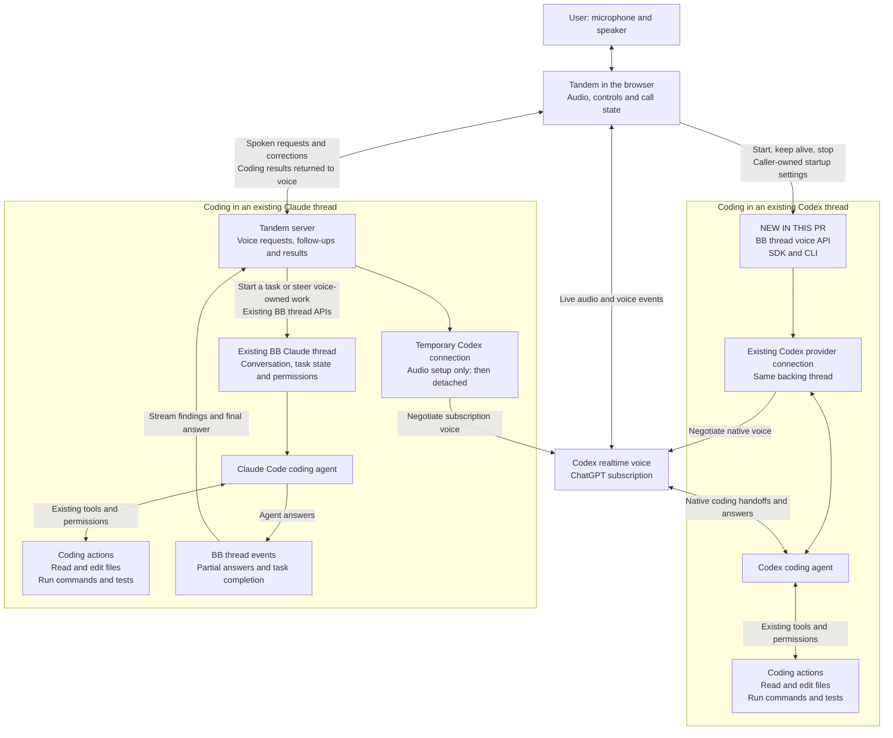

# Tandem and the proposed BB changes

Tandem lets a BB user talk to a coding agent rather than type every request. Its voice conversation uses Codex subscription audio, while the coding task can run in an existing Codex or Claude thread. A user can discuss a change in a Claude thread, hear findings as they arrive, and correct the request while the work continues. Normal BB tool approvals and thread controls still apply.

## Why this is a separate plugin

The reusable part of the experience is the conversation around the coding task: microphone and playback, persistent call controls, spoken corrections, follow-up delivery, incremental results and optional thread background. Those concerns are shared by Codex and Claude; putting a complete voice interface inside each provider would duplicate them.

Keeping Tandem separate lets that behavior evolve without making BB core own its prompts, briefing strategy or UI. It also makes the Claude use case explicit: the voice model and the coding agent do not have to be the same service. This is an ownership and release choice. The same boundaries could support a BB-maintained voice frontend; a plugin is not required merely to offer settings.

## How the pieces fit together

Tandem uses Codex subscription voice for both coding providers. BB still owns the coding threads and their permissions. The new operation in this PR supplies access to the native Codex connection; the Claude path uses existing BB thread APIs.

The diagram shows logical responsibilities, not every network hop. Both paths use Codex’s audio capability; the Claude path has its own temporary audio-setup connection and does not reuse a Codex coding thread. Native Codex handoffs remain on the original connection, so Tandem does not submit them again. The plugin owns prompts, selected background and conversation delivery; core owns access, connection routing and lifecycle.

## What stays in BB

BB owns the backing thread’s provider process, tools, permissions, access checks and lifecycle. A plugin cannot safely reach inside the running Codex process through the existing SDK. Opening another writer for that coding thread would create coordination problems and would not inherently preserve native realtime delegation.

The proposed native voice operation lets a caller negotiate audio on that existing connection. BB routes start, keep-alive and stop commands through its normal server, host and provider path. Codex translates them to its realtime protocol. Session identifiers protect a newer call from an old client’s stop request, timeouts clean up failed negotiation, and a renewable lease releases abandoned calls. An active call keeps its provider session from being reaped as idle. Ending voice does not cancel the coding task.

The operation is Codex-focused. An optional provider capability defaults off. We are not proposing a general audio-provider framework or another live-audio backend.

## What stays in Tandem

Tandem owns browser audio, waveform and call controls, navigation behavior, spoken-context selection, follow-up ownership and result delivery. It also owns the wording supplied to the voice model and backing agent, and the optional synthesis and cache of recent thread background.

For native Codex, requests and coding handoffs remain on the existing provider connection. Tandem must not submit the same native delegation again through `threads.send`.

For Claude, Tandem temporarily starts an isolated, ChatGPT-authenticated Codex audio transport and detaches it after negotiation. Spoken work goes through BB’s existing Claude thread APIs; thread events provide incremental results. It steers only work owned by that voice call and does not silently take over an unrelated task. This path does not require putting Claude behavior inside the Codex provider.

## Two independent core contributions

### Native voice on an existing Codex thread

The transport proposal exposes `threads.experimental_voice` and the matching `bb thread voice` commands. A client supplies its WebRTC offer and receives the answer. Optional bounded startup fields select the voice, provide initial reference text and set call-scoped instructions for native coding handoffs. BB does not choose or synthesize that text. An explicit empty initial reference suppresses native startup history; omitting the field retains provider defaults. There is no midcall context-update operation in this proposal.

This lets Tandem supply its own behavior and startup briefing without embedding Tandem prompts or history queries in BB. Other callers, including a future built-in frontend, can choose different initial text through the same path.

The prototype comes from the native implementation in closed PR [#7576](https://github.com/get-bb/bb/pull/7576), reduced to its server/provider capability. The earlier PR bundled browser UI and context policy; this contribution does not. The voice PR is [PR #7621](https://github.com/get-bb/bb/pull/7621). The open feature discussion is [#7575](https://github.com/get-bb/bb/issues/7575). The experimental API, session ownership and Codex lifecycle extension remain explicit review points.

### Initialize a thread before its first coding task

A user pressing Start voice on New thread needs a real backing thread and a ready provider connection before the first spoken request. Sending a dummy text request would run a task the user never asked for. Creating the thread when the page merely opens would create unwanted threads.

The initialization proposal accepts `input: []`, initializes the provider without running a model turn, and settles the thread to idle. A real message arriving during initialization is submitted after initialization completes. The CLI adds `bb thread spawn --initialize-only`; SDK callers use the existing spawn API with empty input. Scheduled starts still require an initial message.

The implementation is proposed in [PR #7620](https://github.com/get-bb/bb/pull/7620), tracking Tandem’s [issue #7619](https://github.com/get-bb/bb/issues/7619). This is related to Conductor’s blank-chat issue [#7569](https://github.com/get-bb/bb/issues/7569), but its acceptance criteria differ. Conductor proposes a pending thread without a provider session. Tandem needs the connection ready for voice. Our contribution describes and tests that eager initialization; it does not claim to implement Conductor’s pending-thread design. Both native voice and initialization can be reviewed independently, and neither adds an automatic-draft workflow.

## Compatibility and evidence

The running Tandem preview uses a customized BB build with older `threads.voice` startup-briefing and voice-selection fields. The plugin prefers the proposed experimental API when it is available and retains that existing connection path for the current installation. This is not a second audio transport or duplicate writer.

The proposed PRs are not a claim that the current preview works on stock BB, and opening a PR does not deploy it. Exact source dependencies, test results and device limitations are recorded in release.md and in each PR. The transport contribution alone does not add new-thread creation; initialization alone does not add voice.

## Code lineage and attribution

The native adapter is extracted from the author’s earlier BB voice implementation in #7576. Tandem’s browser client also evolved from that implementation. The existing MIT license and copyright attribution are preserved. The plugin repository starts with a consolidated snapshot, so its Git history is not a complete independent audit of every earlier source influence.
